<a href="https://shoaebmalik19.github.io/ShoaebMalik19/">
  
</a>

<div align="center">

[](https://shoaebmalik.in)
[](mailto:shoaebmalik19@gmail.com)
[](https://shoaebmalik19.github.io/ShoaebMalik19/)
[](https://github.com/ShoaebMalik19?tab=followers)


</div>

<br>

<div align="center">
  
</div>

<br>

## ⚡ what i'm cooking

<table>
<tr>
<td width="50%" valign="top">

### 🛡️ [Redaction Model](https://github.com/ShoaebMalik19/Redaction_model)
On-device PII redaction so browser agents never see your faces, IDs or passwords. ONNX + OCR, runs locally. Built for **SIH**.

`ONNX` `OCR` `privacy` `browser-agents`

</td>
<td width="50%" valign="top">

### 📈 [Trading RAG](https://github.com/ShoaebMalik19/Trading_RAG)
A RAG chatbot that answers Smart Money Concepts questions **only** from your own strategy notes. No hallucinated alpha.

`LangChain` `ChromaDB` `Gemini` `Python`

</td>
</tr>
<tr>
<td width="50%" valign="top">

### 🧴 [Supliments](https://github.com/ShoaebMalik19/supliments)
Multi-tenant private-label supplement SaaS: design the label, sync to Shopify, route orders to manufacturers.

`Next.js` `TypeScript` `Drizzle` `Shopify`

</td>
<td width="50%" valign="top">

### 🔏 [Truth Stamp](https://github.com/ShoaebMalik19/Truth_stamp) · [live ↗](https://truth-stamp.vercel.app)
A digital notary on Flare: stamp a file's fingerprint on-chain and prove your content is the original.

`Solidity` `Flare` `Web3` `TypeScript`

</td>
</tr>
<tr>
<td width="50%" valign="top">

### 💸 [PayShard Wallet](https://github.com/ShoaebMalik19/PayShard-Wallet)
A mobile-first Shardeum wallet with passkey-protected PayLinks. Sending crypto feels like sharing a UPI link.

`Hardhat` `Shardeum` `Passkeys` `React`

</td>
<td width="50%" valign="top">

### 🚨 [Rakshak](https://github.com/ShoaebMalik19/Rakshak)
A women's safety app with hold-to-SOS, a safety map, journey watch and fake call. Built with Expo + React Native.

`Expo` `React Native` `TypeScript`

</td>
</tr>
</table>

<details>
<summary><b>🗃️ more from the lab</b></summary>
<br>

| project | what it does | stack |
|---|---|---|
| [🔮 Prediction Market](https://github.com/ShoaebMalik19/Prediction-Market) | on-chain market where experts stake SHM to post predictions | Solidity · Hardhat · React |
| [🎯 Crime Detector](https://github.com/ShoaebMalik19/Crime_detector-) | real-time weapon & fight detection from a webcam | YOLOv8 · MediaPipe · OpenCV |
| [🧠 Feedback Analyzer](https://github.com/ShoaebMalik19/feedback-analyzer) | scores user feedback sentiment with Transformers | Django · Hugging Face |
| [🏅 Sportfo](https://github.com/ShoaebMalik19/Sportfo_1) | a digital sports identity for athletes | Next.js · Supabase |
| [🏠 House Service](https://github.com/ShoaebMalik19/House_service_temp) · [live ↗](https://house-service-temp.vercel.app) | config-driven lead-gen site template for home services | Next.js · Tailwind |
| [🧑‍💻 Portfolio](https://github.com/ShoaebMalik19/portfolio) · [live ↗](https://shoaebmalik.in) | this guy's corner of the internet | Next.js · Framer Motion |

</details>

## 🧰 arsenal

<div align="center">

<br>


</div>

## 🌆 my commits, but make it 3D

<div align="center">
  
</div>

## 🕹️ the arcade

> my contribution graph is a playground. a snake eats it, pac-man chases it, and a breakout paddle smashes it. every 12 hours, automatically.

<div align="center">

<picture>
  <source media="(prefers-color-scheme: dark)" srcset="https://raw.githubusercontent.com/ShoaebMalik19/ShoaebMalik19/output/snake-neon.svg">
  <source media="(prefers-color-scheme: light)" srcset="https://raw.githubusercontent.com/ShoaebMalik19/ShoaebMalik19/output/snake.svg">
  
</picture>

<picture>
  <source media="(prefers-color-scheme: dark)" srcset="https://raw.githubusercontent.com/ShoaebMalik19/ShoaebMalik19/output/pacman-contribution-graph-dark.svg">
  <source media="(prefers-color-scheme: light)" srcset="https://raw.githubusercontent.com/ShoaebMalik19/ShoaebMalik19/output/pacman-contribution-graph.svg">
  
</picture>

<details>
<summary><b>🧱 bonus round: breakout</b></summary>
<br>
<picture>
  <source media="(prefers-color-scheme: dark)" srcset="https://raw.githubusercontent.com/ShoaebMalik19/ShoaebMalik19/output/breakout-contribution-graph-dark.svg">
  
</picture>
</details>

<br>

### wanna actually play something?

<a href="https://shoaebmalik19.github.io/ShoaebMalik19/">
  
</a>

<sub>dodge the 🐛 bugs · grab the commits · ship to prod · works on mobile</sub>

</div>

## 📊 numbers go up

<div align="center">
  
</div>

<br>

<div align="center">

```diff
+ currently: shipping side quests at 3am, fuelled by chai ☕
+ learning:  agentic AI, on-chain infra and making the web feel 3D
- not:       a fan of light mode (no offense)
```

<sub>⭐ if something here helped you, a star means a lot · built with way too much love by <a href="https://github.com/ShoaebMalik19">@ShoaebMalik19</a></sub>

</div>
