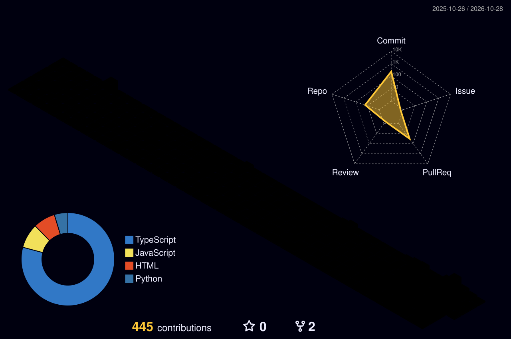

  
  
  

### About

I'm a software engineer working across **applied AI, full-stack product engineering and Web3**. I care about the unglamorous parts that make software trustworthy: tenant isolation, tests that run against a real database, privacy that stays on the device, and contracts small enough to reason about.

- **Building:** a multi-tenant commerce SaaS on Postgres row-level security with a Shopify order loop
- **Recently:** on-device PII redaction for browser agents, built for an ISRO problem statement at Smart India Hackathon
- **Interested in:** LLM systems and retrieval, applied computer vision, and secure smart-contract design

### Selected work

<table>
<tr>
<td width="50%" valign="top">

**[Supliments](https://github.com/ShoaebMalik19/supliments)** 
Multi-tenant SaaS · TypeScript

Private-label supplement platform: brands design labels, publish to Shopify, and orders route to manufacturers. Tenant isolation is enforced with **Postgres RLS** and a permanent isolation test suite. Print-ready PDFs are rendered server-side, and a retrying job queue has a dead-letter state.

`Next.js` `PostgreSQL` `Drizzle` `Supabase` `Shopify API` `Vitest` `GitHub Actions`

</td>
<td width="50%" valign="top">

**[PII Redaction Engine](https://github.com/ShoaebMalik19/Redaction_model)** 
On-device AI · Smart India Hackathon (ISRO)

A privacy layer that sits in front of a browser agent's LLM call. It finds faces, passwords, IDs and names in screenshots **entirely client-side**, combining an RF-DETR PII model, SCRFD face detection, OCR and DOM signals.

`ONNX Runtime Web` `Tesseract.js` `Hugging Face` `Chrome MV3`

</td>
</tr>
<tr>
<td width="50%" valign="top">

**[SportFo](https://github.com/ShoaebMalik19/sportfo)** 
Team product · Next.js

A sports identity platform for Indian athletes. I built the **Gemini AI coach** (streaming, voice input, six languages), the multi-step registration wizard, athlete discovery and Stories.

`Next.js` `Supabase` `Gemini API` `GSAP` `Framer Motion`

</td>
<td width="50%" valign="top">

**[PayShard Wallet](https://github.com/ShoaebMalik19/PayShard-Wallet)** 
Web3 · PWA

Send crypto the way you'd share a UPI link. Funds are locked in a **PayLink** contract and claimed with a passkey whose hash is the only thing stored on-chain. Installable as a PWA.

`Solidity` `Hardhat` `wagmi` `viem` `React` `Shardeum`

</td>
</tr>
<tr>
<td width="50%" valign="top">

**[Truth Stamp](https://github.com/ShoaebMalik19/Truth_stamp)** · [live ↗](https://truth-stamp.vercel.app) 
Web3 · Content provenance

An on-chain notary on Flare. It stamps content hashes and classifies new uploads as original or derived by **perceptual-hash Hamming distance**, with FDC attestation and FTSO timestamps.

`Solidity` `OpenZeppelin` `Flare` `Next.js` `wagmi`

</td>
<td width="50%" valign="top">

**[Trading RAG](https://github.com/ShoaebMalik19/Trading_RAG)** 
LLM · Retrieval

A retrieval-augmented assistant for Smart Money Concepts. It answers **only from your own strategy notes** and refuses when the retrieved context isn't enough.

`LangChain` `ChromaDB` `Gemini` `Python`

</td>
</tr>
</table>

More: [prediction market](https://github.com/ShoaebMalik19/Prediction-Market) · [real-time violence detection](https://github.com/ShoaebMalik19/Crime_detector-) · [sentiment analyzer](https://github.com/ShoaebMalik19/feedback-analyzer) · [all repositories →](https://github.com/ShoaebMalik19?tab=repositories)

### Stack

  

| | |
|---|---|
| **AI / ML** | LLM apps with LangChain, Gemini and OpenAI (streaming, tool calling) · RAG with ChromaDB · ONNX Runtime Web · Tesseract.js OCR · YOLOv8 · MediaPipe · Hugging Face Transformers |
| **Frontend** | TypeScript · React · Next.js App Router · Tailwind CSS · Radix / shadcn · Framer Motion · GSAP · Vite · PWAs |
| **Backend & data** | Node.js · Express · Django · PostgreSQL with row-level security · Drizzle ORM · Supabase (Auth, Edge Functions) · Zod |
| **Web3** | Solidity · Hardhat · OpenZeppelin · viem · wagmi · ethers.js · Shardeum · Flare (FDC, FTSO) |
| **Commerce** | Shopify apps (OAuth, webhooks, fulfillment) · Liquid theme development |
| **Quality & delivery** | Vitest · Hardhat tests · GitHub Actions CI · Vercel |

### Activity

  

<picture>
  <source media="(prefers-color-scheme: dark)" srcset="https://raw.githubusercontent.com/ShoaebMalik19/ShoaebMalik19/output/snake-dark.svg">
  <source media="(prefers-color-scheme: light)" srcset="https://raw.githubusercontent.com/ShoaebMalik19/ShoaebMalik19/output/snake.svg">
  
</picture>

---

  Open to <b>software engineering and AI engineering roles</b> and selected freelance builds. The quickest way to reach me is <a href="mailto:shoaebmalik19@gmail.com">email</a>. 
  Side project: <a href="https://shoaebmalik19.github.io/ShoaebMalik19/">Commit Runner</a>, a small canvas game I made for this profile.

